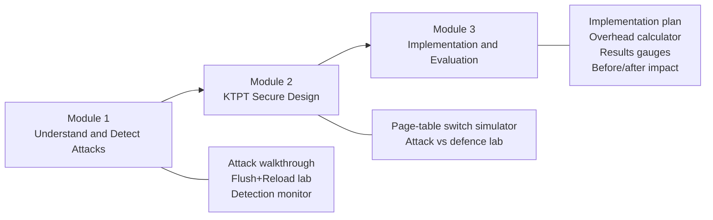
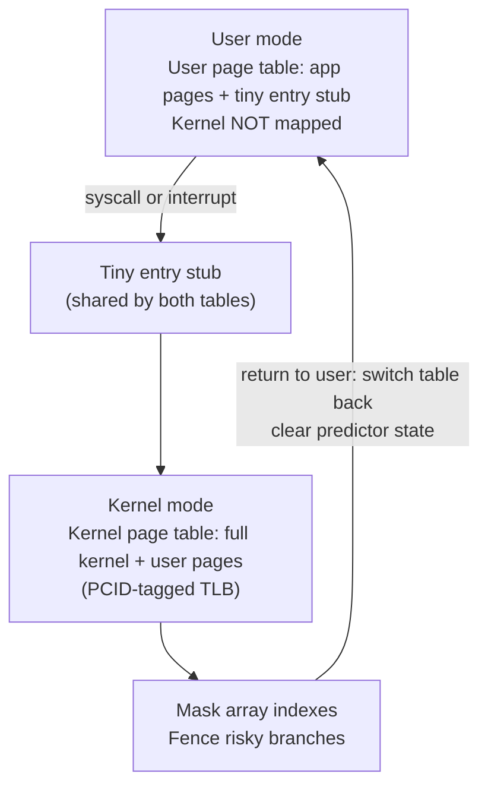
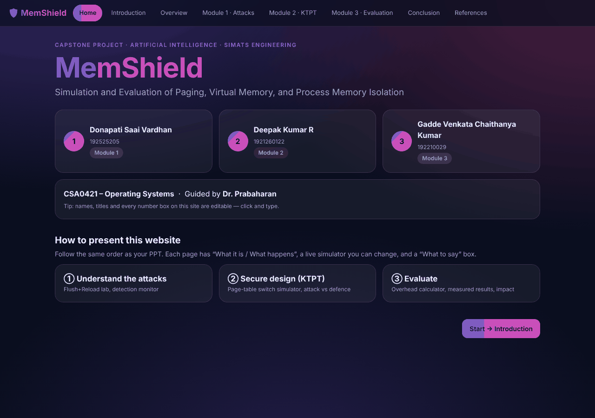
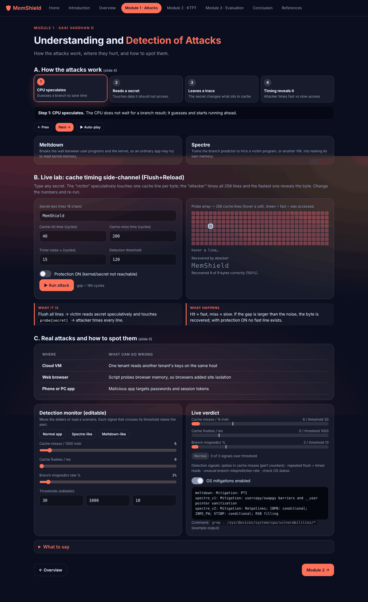
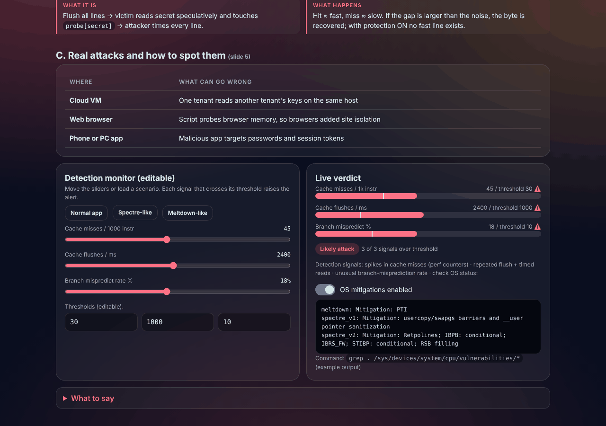
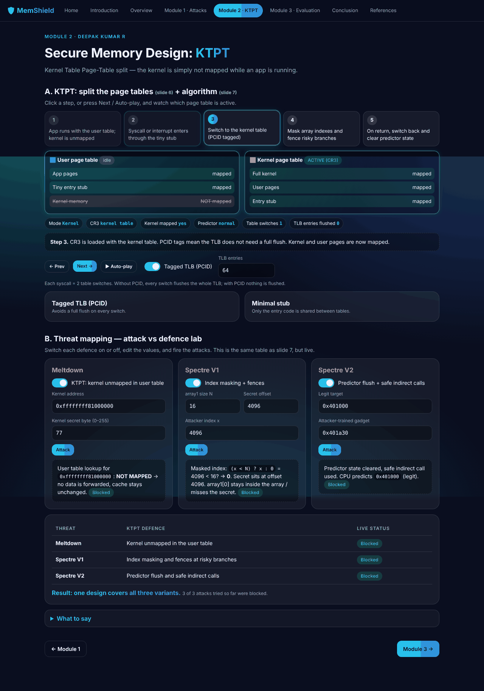
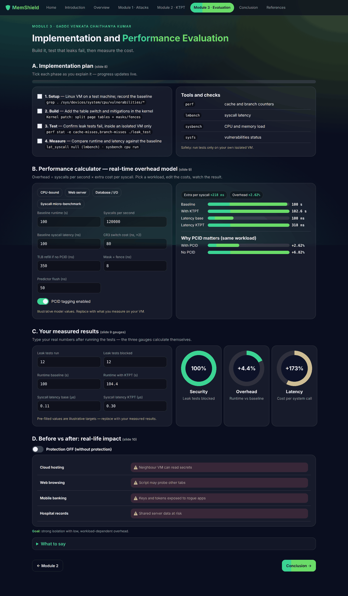

# 🛡️ MemShield

### Simulation and Evaluation of Paging, Virtual Memory, and Process Memory Isolation

**Course:** CSA0421 – Operating Systems | **Institution:** SIMATS Engineering | **Guide:** Dr. Prabaharan

| Team member | Register No. | Module |
|---|---|---|
| Donapati Saai Vardhan | 192525205 | 1 – Understanding and Detection of Attacks |
| Deepak Kumar R | 1921260122 | 2 – Secure Memory Management Design (KTPT) |
| Gadde Venkata Chaithanya Kumar | 192210029 | 3 – Implementation and Performance Evaluation |

---

## Table of Contents
1. [Introduction](#1-introduction)
2. [Abstract](#2-abstract)
3. [Problem Statement](#3-problem-statement)
4. [Objectives](#4-objectives)
5. [System Architecture](#5-system-architecture)
6. [Technology Stack](#6-technology-stack)
7. [Modules and Implementation Details](#7-modules-and-implementation-details)
8. [Software and Hardware Requirements](#8-software-and-hardware-requirements)
9. [Installation](#9-installation)
10. [Execution Steps](#10-execution-steps)
11. [Screenshots](#11-screenshots)
12. [Results and Conclusion](#12-results-and-conclusion)
13. [Presentation (PPT)](#13-presentation-ppt)
14. [References](#14-references)
15. [Repository Structure](#15-repository-structure)

---

## 1. Introduction

In January 2018, the **Spectre** and **Meltdown** vulnerabilities were publicly disclosed. They affect billions of devices, including PCs, phones and cloud servers. These attacks do not exploit ordinary coding bugs. They abuse **speculative execution**, a speed feature of modern CPUs in which the processor guesses ahead and may touch data it should not access. The secret is never shown directly; it leaves a trace in the CPU cache that an attacker can measure.

**MemShield** studies how paging and virtual memory, the tools an operating system uses to isolate processes, can be used to defend against these attacks. The project is delivered as an **interactive website** (a single HTML file) containing simulators for each module, together with a PowerPoint presentation.

## 2. Abstract

MemShield explains and simulates how speculative-execution attacks (Meltdown, Spectre V1 and Spectre V2) leak kernel and cross-process memory. It then presents **KTPT (Kernel Table Page-Table split)**, a memory-isolation design in which the kernel is not mapped in the page table used while an application runs. The kernel page table is used only while the kernel runs, and a tagged TLB (PCID) avoids a full TLB flush on every switch. Index masking, fences and predictor flushing address Spectre V1 and V2. The project also covers a plan to build and test the design on a Linux VM and a model to estimate performance overhead. The website simulators use illustrative values, so the performance figures in this README are **expected values, not measured results**.

## 3. Problem Statement

Speculative-execution attacks can leak kernel memory and the memory of other processes or virtual machines through cache-timing side channels. Real-life impact described in the project:

| Where | What can go wrong |
|---|---|
| Cloud servers | A rented VM could read a neighbour's data |
| Web browsers | A web page script may probe other tabs |
| Banking and UPI apps | A rogue app could sniff keys and tokens |
| Hospital systems | Patient records on shared servers are at risk |

The challenge is to stop these leaks **without crippling performance**.

## 4. Objectives

1. Explain how Meltdown, Spectre V1 and Spectre V2 work.
2. Demonstrate the cache-timing side channel (Flush+Reload) in a safe, simulated lab.
3. Show how attacks can be detected using performance signals and OS status.
4. Present the KTPT design and map each attack to its defence.
5. Provide a build, test and measurement plan for evaluating the design.
6. Estimate performance overhead using an editable calculator.

## 5. System Architecture

The project flows in three stages: **attack understood → defence designed → defence measured**.



**KTPT page-table design** (from Module 2):



## 6. Technology Stack

| Item | Used for |
|---|---|
| HTML5, CSS3 | Page structure and styling (single file, no framework) |
| JavaScript (vanilla) | All simulators and interactivity |
| Google Fonts (Space Grotesk, JetBrains Mono) | Typography (loaded online) |
| Mermaid (in this README) | Architecture diagrams, rendered by GitHub |

The website has **no backend, no build step and no external libraries**. Everything is in `Capstone/source/index.html`.

## 7. Modules and Implementation Details

### Module 1 – Understanding and Detection of Attacks (Donapati Saai Vardhan)

Concepts: how the attacks work, real attack scenarios, and detection.

- **Attack walkthrough:** four clickable steps (CPU speculates → reads a secret → leaves a trace in cache → timing reveals it), with Prev/Next and auto-play.
- **Flush+Reload lab:** you type a secret of up to 16 characters. For each byte, the simulation makes 256 cache-line timings. One line is "fast" (cache hit) and the rest are "slow" (cache miss), with random timer noise added. The fastest line below the threshold is the recovered byte. Hit time, miss time, noise and threshold are editable. With **Protection ON**, no fast line exists and nothing is recovered.
- **Detection monitor:** three sliders (cache misses per 1000 instructions, cache flushes per ms, branch-mispredict rate %) are compared with editable thresholds. The verdict is Normal, Watch, Suspicious or Likely attack, depending on how many signals cross their thresholds. Presets: Normal app, Spectre-like, Meltdown-like.
- **OS status example:** a toggle shows example output of `grep . /sys/devices/system/cpu/vulnerabilities/*`, with mitigations enabled or "Vulnerable".

### Module 2 – Secure Memory Management Design: KTPT (Deepak Kumar R)

- **Page-table switch simulator:** five steps show which page table is active (CR3). The steps are: app runs with the user table, syscall enters through the stub, switch to kernel table, mask and fence, return and clear predictor state. It counts table switches and, with **PCID turned off**, counts the TLB entries flushed.
- **Attack vs defence lab:**

| Threat | KTPT defence | What the simulator does |
|---|---|---|
| Meltdown | Kernel unmapped in the user table | With the defence on, the kernel address is "NOT MAPPED" and nothing leaks |
| Spectre V1 | Index masking and fences at risky branches | Uses the masked index `(x < N) ? x : 0` and checks whether it reaches the secret offset |
| Spectre V2 | Predictor flush and safe indirect calls | The CPU predicts the legitimate target instead of the attacker-trained gadget |

  Each defence can be switched off to see the attack succeed. A summary table shows Blocked or LEAKED.

### Module 3 – Implementation and Performance Evaluation (Gadde Venkata Chaithanya Kumar)

- **Implementation plan (checklist):** Setup (Linux VM, record baseline) → Build (table switch and mitigations in the kernel) → Test (confirm leak tests fail, in an isolated VM only) → Measure (compare runtime and latency with baseline).
- **Tools named in the plan:** `perf` (cache and branch counters), `lmbench` (syscall latency), `sysbench` (CPU and memory load), `sysfs` vulnerabilities status.
- **Overhead calculator:** Overhead = syscalls per second × extra cost per syscall. Extra cost = 2 × CR3 switch + (TLB refill, only without PCID) + mask/fence + predictor flush. Workload presets: CPU-bound, Web server, Database/I/O, Syscall micro-benchmark. A comparison shows why PCID matters.
- **Results gauges:** security (leak tests blocked), overhead (runtime vs baseline) and latency (cost per system call) are calculated from the numbers entered.
- **Before vs after:** a toggle compares cloud hosting, web browsing, mobile banking and hospital records with protection off and on.

> **Scope note:** The website is a **simulation and teaching tool**. This repository does not contain a modified Linux kernel or real exploit code. The Build and Test steps in Module 3 are a plan, described on slide 8 of the PPT.

## 8. Software and Hardware Requirements

**Software**
- Any modern web browser (Chrome, Edge, Firefox or Safari)
- Internet connection (optional): only to load Google Fonts. The site works offline with fallback fonts.
- Git (only if you want to clone the repository)

**Hardware**
- Any PC, laptop or phone able to run a modern browser. No special hardware is needed.

**For the planned kernel evaluation (Module 3 plan, not included in this repo):** a Linux VM on a test machine, with `perf`, `lmbench` and `sysbench` installed.

## 9. Installation

No dependencies are required.

```bash
# Clone the repository
git clone https://github.com/svdchikku-design/CSA0421-Operating_System.git

# Go to the project folder
cd CSA0421-Operating_System/Capstone/source
```

Alternatively, download the repository with **Code → Download ZIP** on GitHub and extract it.

## 10. Execution Steps

1. Open the `Capstone/source` folder.
2. Double-click `index.html`, or run one of these commands:

```bash
# Linux
xdg-open index.html

# macOS
open index.html

# Windows (Command Prompt)
start index.html
```

3. Optional: serve it locally instead.

```bash
python3 -m http.server 8000
# then open http://localhost:8000 in your browser
```

4. Use the top menu: Home → Introduction → Overview → Module 1 → Module 2 → Module 3 → Conclusion → References. You can also use the ← and → arrow keys.

> Any real leak tests described in the plan must be run **only on your own isolated VM**.

## 11. Screenshots

Screenshots were captured from the actual website in `Capstone/source/index.html`.

| Home page | Module 1 – Flush+Reload lab and detection monitor |
|---|---|
|  |  |

| Module 1 – Detection (Spectre-like preset) | Module 2 – KTPT simulator and attack vs defence |
|---|---|
|  |  |

**Module 3 – Implementation plan, calculator and gauges**



## 12. Results and Conclusion

### Expected results

> ⚠️ **These are expected (illustrative) values.** They are the default values in the simulator and in slide 9 of the PPT. They are **not measured** results from a real kernel build.

| Metric | Expected value |
|---|---|
| Security: leak tests blocked | 12 of 12 (100%) |
| Runtime overhead | 100 s baseline → 104.4 s with KTPT (+4.4%) |
| Syscall latency | 0.11 µs → 0.30 µs (about +173%) |

The calculator also shows that overhead depends on the workload: a CPU-bound program barely notices the change, while a syscall-heavy program pays more. In the model, PCID tagging keeps the cost lower than flushing the TLB on every switch.

### Conclusion

- Spectre and Meltdown abuse speculation, not coding bugs.
- KTPT hides the kernel by splitting page tables.
- Masking, fences and predictor flushes cover Spectre.
- Overhead is expected to stay manageable with PCID tagging.

**Future scope:** hardware-level fixes in newer CPUs; ML-based real-time attack detection; testing on ARM, RISC-V and containers.

## 13. Presentation (PPT)

The project presentation (12 slides) is in this repository:

📄 [`presentation/MemShield.pptx`](presentation/MemShield.pptx)

## 14. References

1. Kocher et al., *Spectre Attacks: Exploiting Speculative Execution*, IEEE S&P 2019.
2. Lipp et al., *Meltdown: Reading Kernel Memory from User Space*, USENIX Security 2018.
3. Linux Kernel Documentation, *Page Table Isolation (PTI)*, kernel.org.
4. *GhostRace: Exploiting and Mitigating Speculative Race Conditions*, USENIX Security 2024.
5. *Indirector: Branch Target Injection via the Indirect Branch Predictor*, USENIX Security 2024.
6. *InSpectre Gadget: Residual Attack Surface of Cross-privilege Spectre v2*, USENIX Security 2024.

## 15. Repository Structure

```
Capstone/
├── README.md                  ← this file
├── source/
│   └── index.html             ← MemShield interactive website (all code)
├── presentation/
│   └── MemShield.pptx         ← project PPT
└── screenshots/
    ├── 01-home.png
    ├── 02-module1-attack-lab.png
    ├── 03-module1-detection.png
    ├── 04-module2-ktpt.png
    └── 05-module3-evaluation.png
```
